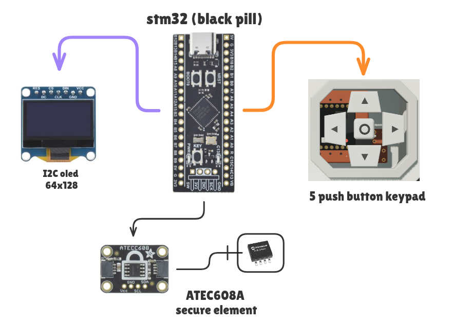

# Noir Wallet - Ethereum Hardware Wallet

  
  
  
   
  <strong>Secure, offline Ethereum transaction signing on STM32F401 (BlackPill)</strong>
   
  <a href="https://noirwallet.blocsoc.in">noirwallet.blocsoc.in</a>

---

## Overview

Noir Wallet is a **hardware wallet** for Ethereum running on the **STM32F401CCU6 microcontroller** (WeAct BlackPill). It provides offline transaction signing with PIN protection, human-readable transaction verification on an OLED display, and USB HID communication with MetaMask and other Ethereum dApps.

### Key Features

- ✅ **Offline Signing**: Private keys stay on device
- ✅ **PIN Protection**: 4-digit PIN before any signing
- ✅ **OLED Display**: 128×64 shows transaction details
- ✅ **5 Push Buttons**: Full user interaction
- ✅ **WebHID Compatible**: Works with browsers via USB
- ✅ **MetaMask Ready**: Direct integration with MetaMask
- ✅ **Secure Element**: ATECC608A wired in for entropy + serial (see [ATECC-NOTES.md](./schematics/ATECC-NOTES.md))

---

## Build

  
  

  
  

3D-printed case files live in [CAD/](./CAD) (`case_v2`, `front_pannel_v3`).

---

## Hardware

### Required
- **MCU**: STM32F401CCU6 (WeAct BlackPill)
- **Display**: SSD1306 128×64 OLED (I2C)
- **Input**: 5× momentary push buttons (GPIO)
- **Secure Element**: ATECC608A (I2C) — entropy source + device serial
- **USB**: USB-A to micro-USB cable

Full pinout and wiring: [schematics/HARDWARE_SPECS.md](./schematics/HARDWARE_SPECS.md).

---

## See Also
- [Noir Wallet site](https://noirwallet.blocsoc.in)
- [STM32F401CC Datasheet](https://www.st.com/resource/en/datasheet/stm32f401cc.pdf)
- [Ethereum Signing](https://ethereum.org/en/developers)
- [WebHID API](https://wicg.github.io/webhid)

**Built for BlocSoc @ University** 🚀

