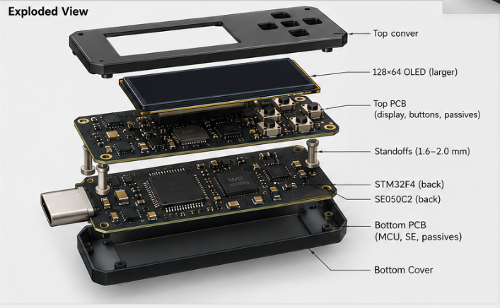
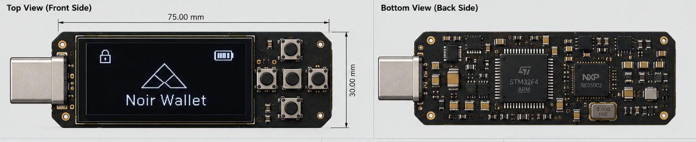
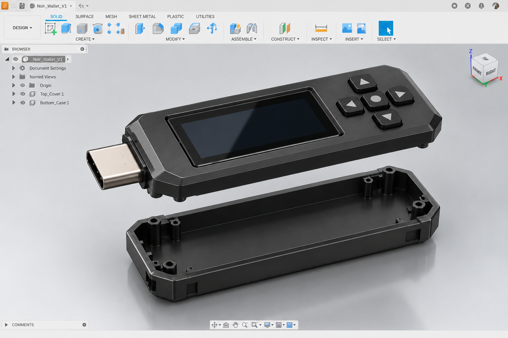
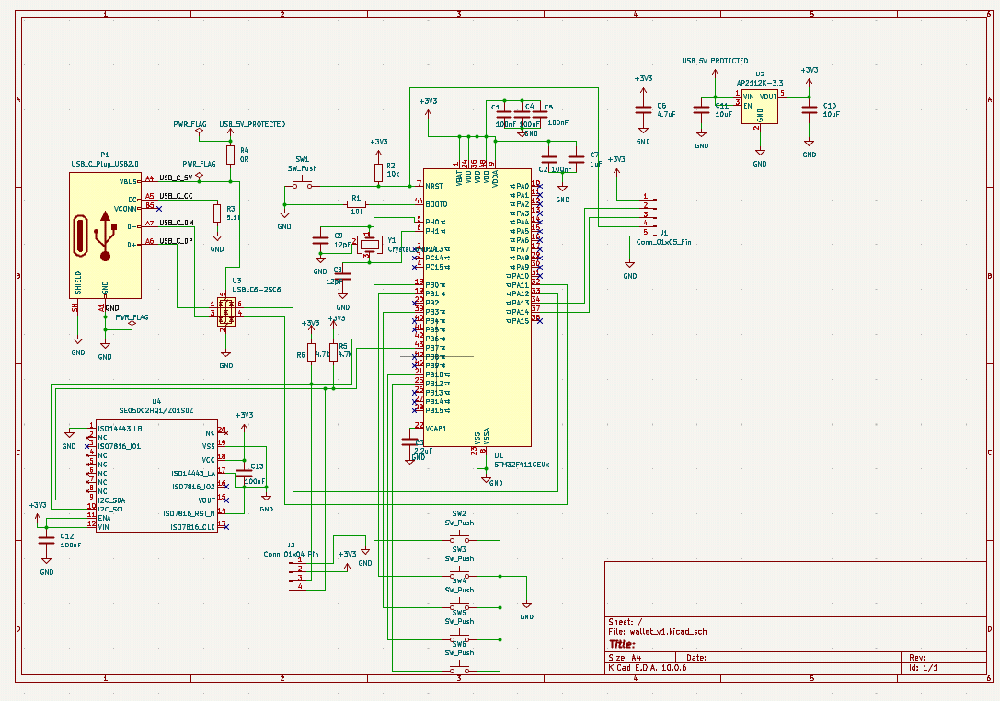

# Noir Wallet

<div align="center">
  
  
  
  
  <br/>
  <strong>Open hardware-wallet research from Blockchain Society, IIT Delhi</strong>
  <br/>
  <a href="https://noirwallet.blocsoc.in">Website</a> ·
  <a href="https://noirwallet.blocsoc.in/paper">Paper</a>
  <br/>
  <br/>
</div>



## 

## Repository layout

```text
.
├── v0/
│   ├── core/          # STM32F401 firmware and host tests
│   ├── CAD/           # V0 enclosure source and STL files
│   ├── schematics/    # V0 wiring, pinout, and ATECC notes
│   ├── assets/        # V0 photographs and diagrams
│   └── publication/   # Public V0 research paper and images
├── v1/
│   ├── PCB/           # KiCad project (wallet_v1): schematic, symbols, ERC
│   ├── assets/        # V1 CAD, schematic and PCB visualization images
│   └── publication/   # Public V1 architecture/security research
├── Proposal/          # Local competition material; ignored by Git
├── LICENSE
└── README.md
```

Root `README.md` is project index. README files under vendored libraries remain
upstream package documentation, not separate Noir Wallet project guides.

## V0: working research prototype

V0 uses STM32F401CCU6, ATECC608A, SSD1306 128×64 OLED, five active-low
buttons, and USB HID enumeration.

Current firmware demonstrates hardware bring-up, BIP-39 mnemonic generation,
Ethereum address derivation, UI, buttons, and USB enumeration. Transaction
frame handling and production signing are not complete: current HID callback
discards incoming frames. ATECC608A is not secp256k1 signing-key store. Treat
V0 as research prototype, not production wallet.

- [Firmware](./v0/core/)
- [Hardware specifications](./v0/schematics/HARDWARE_SPECS.md)
- [CAD](./v0/CAD/)
- [Ledger N3XT paper source](./v0/publication/paper.tex)
- [Ledger N3XT paper PDF](./v0/publication/paper.pdf)

## Status

| Version       | State                                                          |
| ------------- | -------------------------------------------------------------- |
| V0            | Working research prototype (STM32F401 + ATECC608A, hand-wired) |
| V1 schematic  | Done: KiCad 10, ERC 0 errors / 0 warnings                      |
| V1 PCB layout | In progress; routed `.kicad_pcb` not yet published             |
| V1 enclosure  | Fusion CAD model done (top cover + bottom case)                |
| V1 firmware   | Not started on V1 hardware; V0 UI and USB code to be reused    |

## V1: custom pendrive-format board

V1 redesigns the electronics as one 75 x 30 mm 4-layer PCB with a USB-C plug,
targeting non-exportable secp256k1 signing, protected MCU-to-secure-element
communication, and explicit on-device transaction review.

Hardware, per the KiCad schematic in [`v1/PCB/wallet_v1`](./v1/PCB/wallet_v1/):

- MCU: STM32F411CEU6 (QFN-48), bridge MCU; hardened path is an STM32U5-class part
- Secure element: NXP SE050C2HQ1 (HX2QFN20), SCP03 secure channel
- USB-C plug (USB 2.0), USBLC6-2SC6 ESD protection, AP2112K-3.3 LDO
- 128x64 OLED header, 5 UI buttons, reset, SWD header

Known caveats: OLED and SE050C2 share I2C1, so display data is visible on the
bus while SE payloads are SCP03-protected. U4 still needs a custom HX2QFN20
footprint.

### Photos





### V1 research

Secure-element evaluation recommends NXP EdgeLock SE051C2 first and Microchip
TA101 as fallback. Secure-element choice does not independently solve a
compromised MCU or OLED substitution.

- [Secure-element report source](./v1/publication/secure-element-report.tex)
- [Secure-element report PDF](./v1/publication/secure-element-report.pdf)

## Build V0 firmware

Host crypto tests pass from moved layout. Embedded PlatformIO snapshot still
expects a TinyUSB checkout under `v0/core/lib/tinyusb` and valid source links
under `v0/core/src/trezor` and `v0/core/src/usb/tinyusb`; those dependencies
were already incomplete before repository restructuring.

After restoring those dependencies:

```bash
cd v0/core
pio run
```

Host crypto tests:

```bash
cd v0/core
make
./host_test
```

## Links

- [Noir Wallet](https://noirwallet.blocsoc.in)
- [Published paper](https://noirwallet.blocsoc.in/paper)
- [GitHub](https://github.com/Arnav-panjla/noir-wallet)
- [NXP SE050 data sheet](https://www.nxp.com/products/SE050)
- [STM32F401CC data sheet](https://www.st.com/resource/en/datasheet/stm32f401cc.pdf)
- [NXP EdgeLock SE051 data sheet](https://www.nxp.com/docs/en/data-sheet/SE051.pdf)

## License

See [LICENSE](./LICENSE). Vendored dependencies retain their own notices and
licenses.
